# Homework 02 - Message Board

A Flutter message board that uses Firebase. You sign up or log in with email and password, then you land on one shared board where everyone who is signed in can see messages live. You can post, edit, and delete your own messages, but not anyone else's.

## How to run

* `flutter pub get`
* `flutter run`
* `flutter test` to run the app tests
* `flutter build apk --release` to build the APK (it ends up in `build/app/outputs/flutter-apk/app-release.apk`)

## Firebase setup

* The app is already connected to my Firebase project (`messageboard-c2e77`), so it just works if you run it
* `lib/firebase_options.dart` and `android/app/google-services.json` were made with `flutterfire configure`, I didn't write them by hand
* These files only say which project to talk to. They're not passwords. The security rules are what actually protect the data
* To use your own project instead:
  * Make a Firebase project, turn on **Email/Password** sign-in, and create a **Firestore** database
  * Run `flutterfire configure` and pick Android
  * Run `firebase deploy --only firestore:rules`

## What the app does

* Shows a splash screen while Firebase starts up. If it fails, it shows a Retry button instead of crashing
* Register screen asks for first name, last name, role, email, password, and confirm password
* Login screen checks the email format and that the password isn't empty
* Bad input gets a clear message like "Incorrect email or password." and never the raw Firebase error
* The Sign in / Register buttons turn off while they're working, so you can't double submit
* `authStateChanges()` decides what you see. Signed out = login screen, signed in = the board
* You stay signed in after closing and reopening the app
* When you register, it saves your user record in Firestore (`users/{uid}`) with all 5 fields: uid, first name, last name, role, and registration date/time
* The board only opens once that user record exists. If saving it fails, it says "Account created, profile not saved" with a Retry button
* The board updates live with `snapshots()`, so a message from another phone shows up without refreshing
* Your messages are on the right and say "You", other people's are on the left with their name
* Each message shows the time and "edited" if it was changed
* If the board is empty it says "No messages yet" instead of a blank screen
* Only your own messages have the `•••` button (or long press) to edit or delete
* Edit won't let you save an empty message, and delete asks you to confirm first
* Sign out asks you to confirm and takes you back to the login screen

## Data model

Full table with who writes every field is in [`docs/DATA_MODEL.md`](docs/DATA_MODEL.md). Short version:

* `users/{uid}` (private)
  * `uid`, `firstName`, `lastName`, `role`, `registrationDateTime`
  * Written once by the app when you register. The date comes from the server
  * Only you can read it. Nobody can change or delete it after, so the registration date can't be reset
  * `role` is just info about you. It doesn't give any extra permissions
* `messages/{msgId}` (public board)
  * `text`, `authorUid`, `authorName`, `createdAt`, `editedAt`
  * `authorUid` is set to your uid when you post. `createdAt` and `editedAt` come from the server clock, not the phone
* All the Firebase code is in 3 services, so the screens never talk to Firebase directly
  * `AuthService` - sign up, sign in, sign out, current user
  * `UserService` - the `users/{uid}` record
  * `BoardService` - create, read (live stream), update, delete for messages

## Security rules

The rules are in [`firestore.rules`](firestore.rules). Hiding the edit button is just for looks, the rules are what actually stop people.

* You have to be signed in to read the board
* You can only post as yourself (`authorUid` has to match your uid)
* Messages have to be 1 to 500 characters, and `createdAt` has to be the server time
* Only the author can edit or delete a message
* When editing, only `text` and `editedAt` can change. You can't change who wrote it or when
* Only you can read your own user record, and it can't be edited or deleted

### How I tested the rules

* There's a **Rules Check** screen (the shield icon on the board). It sends real requests to Firestore and shows PASS or FAIL for each one:
  * signed-out read and create, forged `authorUid`, editing or deleting someone else's message, changing `authorUid` on my own message, reading someone else's user record, and resetting my own registration date are all **denied**
  * creating, editing, and deleting my own message are **allowed**
* For the signed-out tests it uses a second Firebase instance where nobody is logged in, so Firestore really sees `request.auth == null`
* There are also automatic rules tests (see Spice #2 below)

## Extra Spices (undergrad: Main Spice + 3)

* **Main Spice - Release Readiness Gate:** I tested the release APK with the full checklist (it's in my evidence doc)
* **#1 Emulator Explorer:** the app can run against the local Firebase Emulator Suite instead of the real project
  * `firebase emulators:start --only auth,firestore`
  * `node tools/seed_emulator.mjs` adds 3 test users and 5 messages (password `test1234`)
  * `flutter run --dart-define=USE_EMULATOR=true` (a red EMULATOR banner shows in the corner)
  * Emulator UI is at http://127.0.0.1:4000
  * The seed script only talks to `127.0.0.1`, so the real project never gets touched
* **#2 Rules Unit Tester:** automatic rules tests in `rules_test/rules.test.mjs` (13 tests, all passing)
  * `cd rules_test && npm install` (only the first time)
  * `firebase emulators:exec --only firestore --project demo-message-board "npm --prefix rules_test test"`
* **#4 Idempotent Alchemist:** a double tap or a retry can't make 2 messages
  * Every message gets its id before it's sent, and the create runs in a transaction that skips the write if that id already exists
  * `test/idempotent_post_test.dart` posts the same message twice and checks there's only 1 document
  * The Rules Check screen also has a "Run duplicate check" button that does it against real Firestore

## Tests

* `flutter test` runs 24 tests: splash/retry, form validators, user record, message model, edit dialog, and the double-submit tests
* `flutter analyze` shows no issues

## Files

* `lib/main.dart` - starts the app and shows the splash screen
* `lib/screens/splash_screen.dart` - splash while Firebase starts, with a Retry screen if it fails
* `lib/screens/auth_gate.dart` - picks login/register or the board based on auth state
* `lib/screens/login_screen.dart` and `register_screen.dart` - the forms
* `lib/screens/profile_gate.dart` - makes sure the user record exists before showing the board
* `lib/screens/board_screen.dart` - the live board, the message bubbles, and the composer
* `lib/screens/rules_check_screen.dart` - the in-app rules and duplicate checks
* `lib/services/` - `auth_service.dart`, `user_service.dart`, `board_service.dart`, `rules_probe_service.dart`
* `lib/models/` - `app_user.dart` and `message.dart`
* `lib/emulator_config.dart` - switches the app to the emulators
* `firestore.rules` - the security rules
* `rules_test/` - the automatic rules tests
* `tools/seed_emulator.mjs` - puts test data in the emulator
* `test/` - the Flutter tests

## Screenshots

* Splash screen while Firebase starts (release APK)

  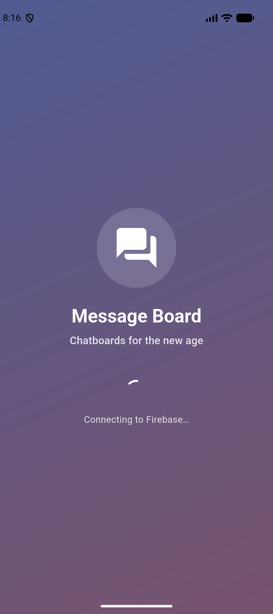

* Login screen

  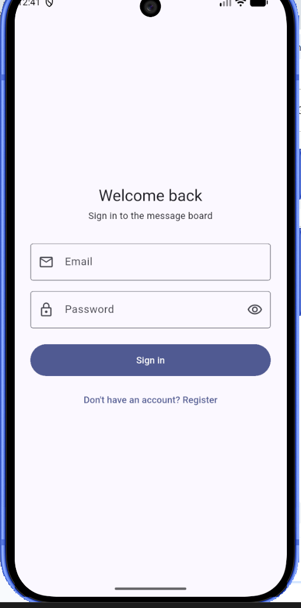

* Registering user A (first name, last name, role, email, password)

  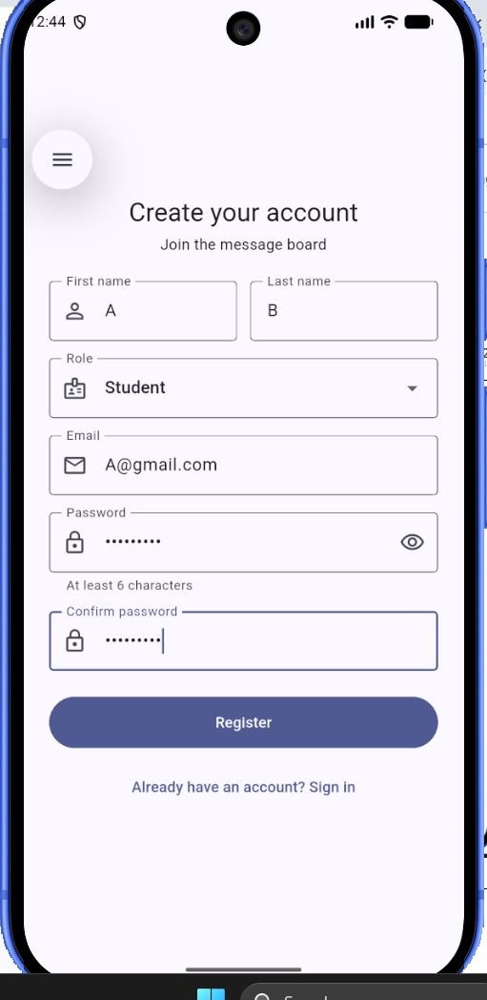

* Empty board right after signing up

  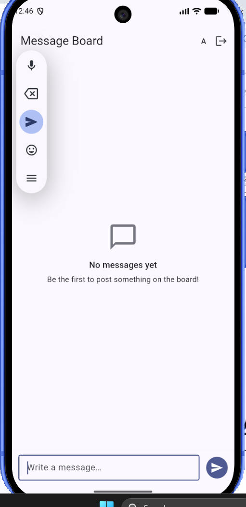

* User A posts a message. It shows on the right as "You"

  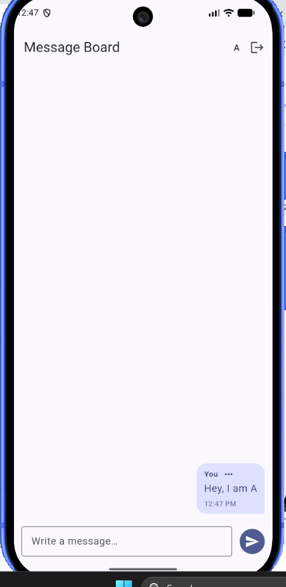

* User C signs in and sees A's message on the left with A's name

  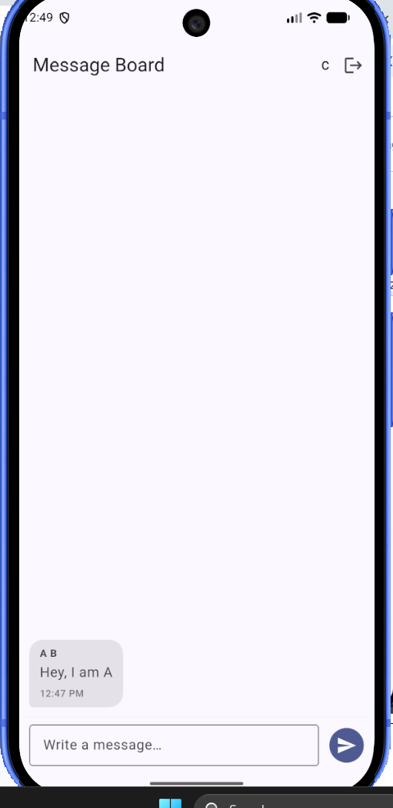

* C posts a reply

  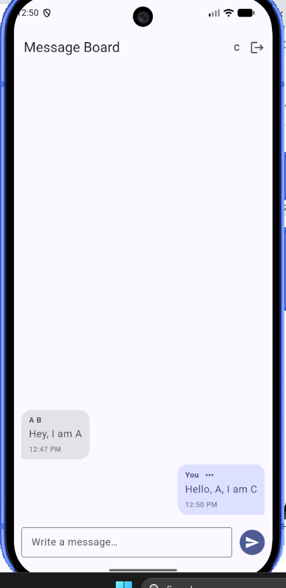

* Only my own message has the edit/delete menu

  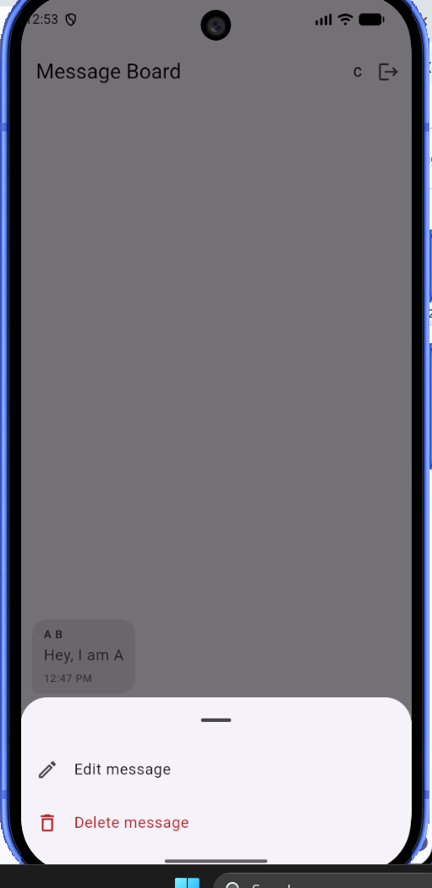

* Editing the message

  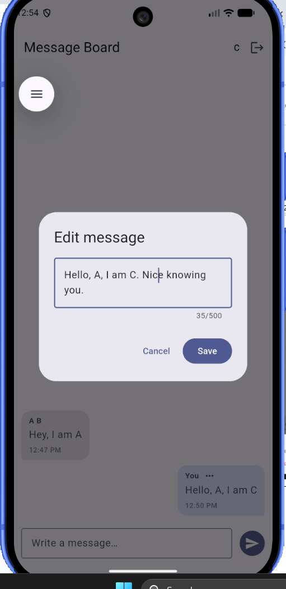

* After saving it says "Message updated." and the bubble says "edited"

  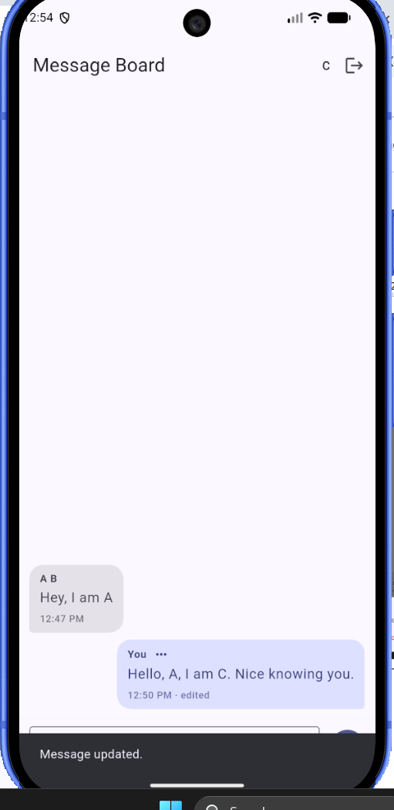

* Back on user A, the edited message from C shows up with no refresh. A can't edit C's message (no `•••` on it)

  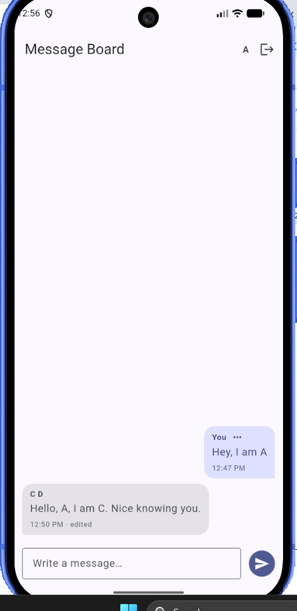

* Delete asks first

  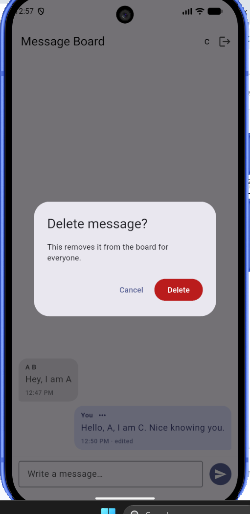

* After deleting, only that one message is gone and A's message is still there

  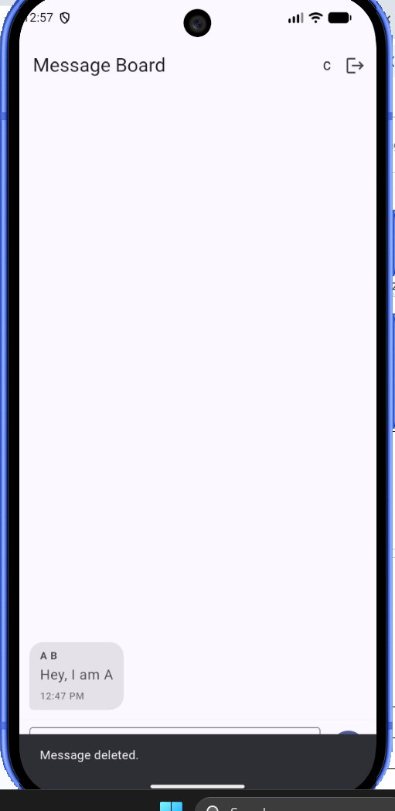

* The two test accounts in Firebase Authentication

  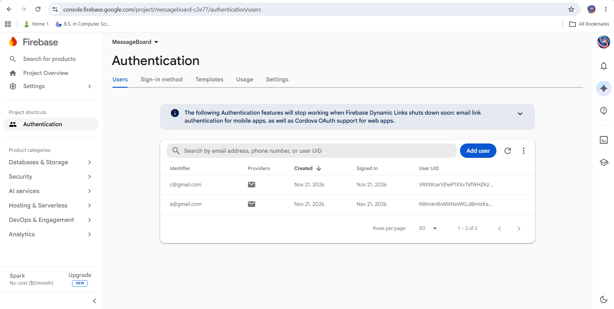

* Rules Check on the release APK: 11 / 11 passed. Signed-out read/create and the forged `authorUid` are all denied by Firestore (`permission-denied`)

  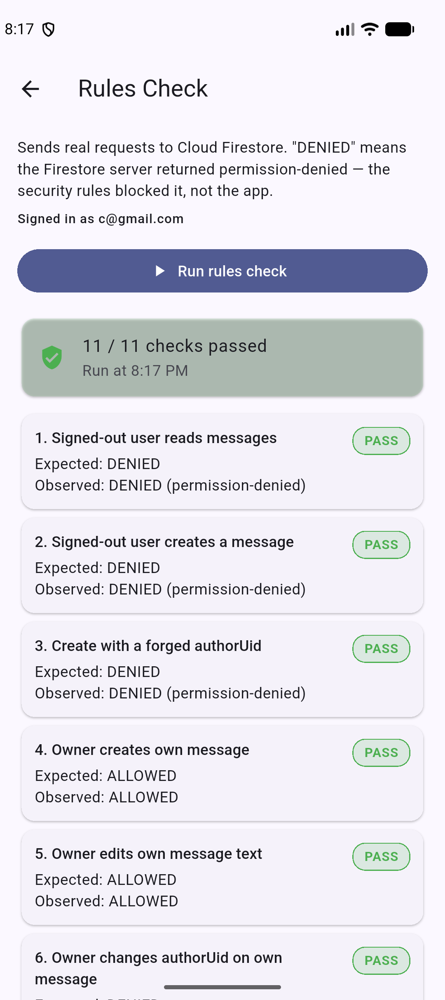

* Rest of the rules checks (editing/deleting someone else's message, reading their user record, resetting my registration date are all denied) and the duplicate check: 2 calls with the same id made only 1 document

  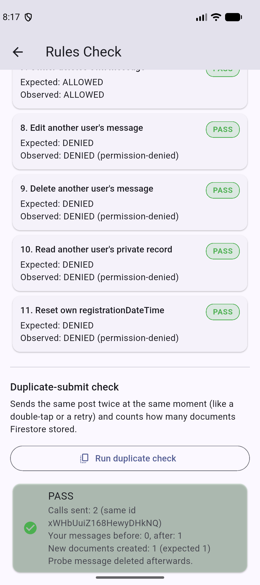

* After fully closing the app and opening it again I'm still signed in and the board loads

  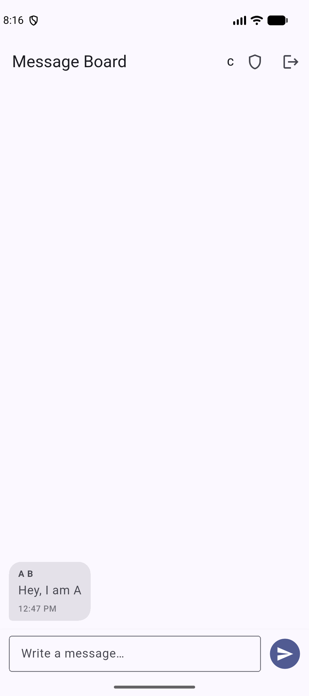
